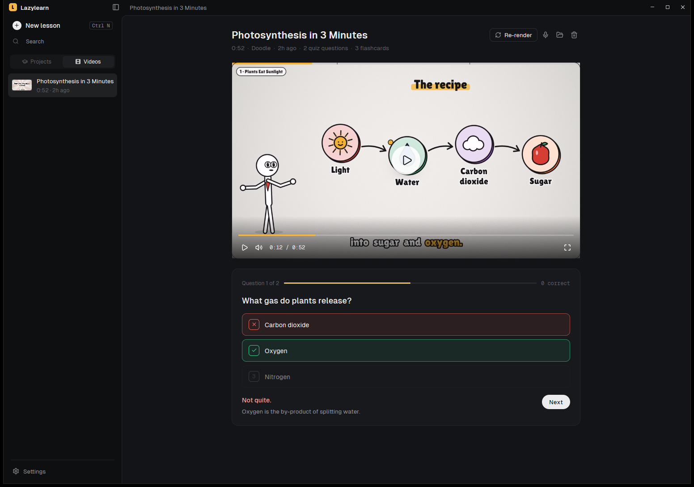
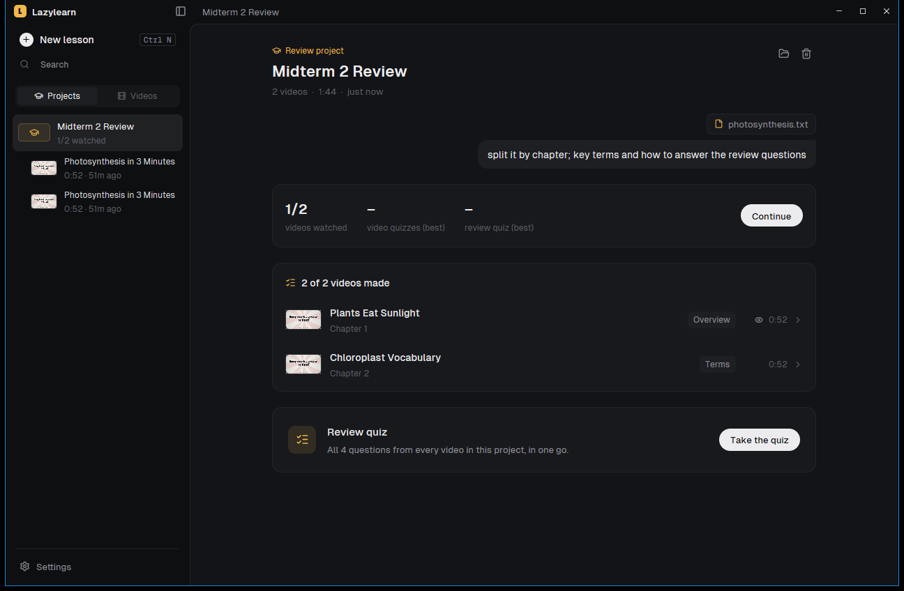
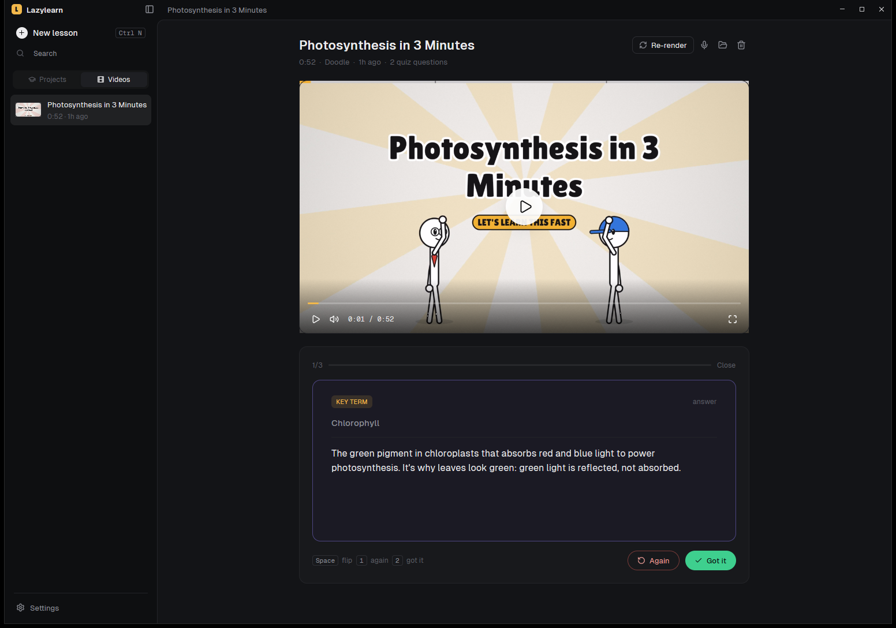
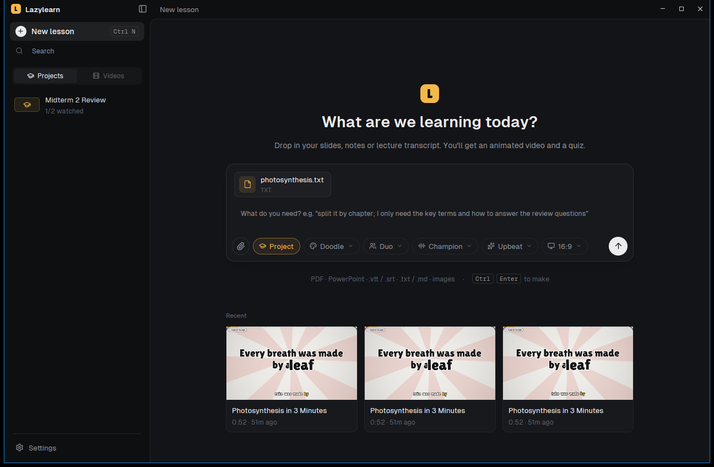

  

<h1 align="center">Lazylearn</h1>

<b>Turn your class material into animated study videos, then lock it in with quizzes and flashcards.</b>

  

---

Studying from a 60-slide deck or a 40-page reading is hard to start and easy to zone out of. Lazylearn
turns that material into something you actually want to watch: short, fast, animated explainer videos
in the style of YouTube Shorts and TikTok study content. They still teach from scratch, so you
understand the material, not just skim it.

Drop in your slides, notes or lecture transcript, say what you need ("chapters 7–11 for my midterm,
I mostly need the key terms"), and Lazylearn writes the lesson, voices it, animates it and renders a
video. When the video ends, a quiz is waiting, then a deck of flashcards.

## What you get

**Animated lessons, not slideshows.** Every video is made of many short shots that change every few
seconds: kinetic titles, definitions, step-by-step flows, cycles, side-by-side comparisons, timelines,
formulas that build themselves, mnemonics, "myth vs. fact" busters and recap checklists. Icons and
diagrams pop in at the exact moment they're mentioned, and every cut has a transition.

**A cast that teaches.** A doodle teacher and a curious student talk through the material together,
with poses, blinking and lip-sync. Or pick a single narrator who talks straight to you. Voices are
generated on your computer, with presets from calm to full YouTube-host energy.

**Captions, sound and music.** Burned-in captions highlight each word as it's spoken. Sound effects
land on every pop and stamp, and background music drops under the voice. Subtitles are saved too.

**Several looks.** Doodle (paper and black line art), Cosmic (neon on deep space), Whiteboard and
Chalk. You can re-render any lesson in another style without remaking it.

**Widescreen or vertical.** Videos are 16:9 by default. Add a 9:16 version for your phone, or make
only the vertical one.

## Projects: a whole review session

  

For an exam you rarely need just one video. A **project** is a full review session: hand Lazylearn a
textbook, a reader or a semester of slides and describe how you want it split, for example "one video
per chapter; I need the term definitions and how to answer the end-of-chapter questions".

Lazylearn reads everything, including diagrams, charts, tables and scanned pages, and proposes a plan:
a list of videos, each with the part of the material it covers and a format:

- **Chapter**: the whole chapter in one video, with every key term and everything you need for the study questions
- **Overview**: the big picture, key ideas, examples and common traps
- **Terms**: a drill of every key term with a definition, an example and a memory hook
- **Questions**: how to answer the review questions, with model answers
- **Cram**: only what's most likely to be on the test, fast

You review the plan, drop the videos you don't need, then let it build. Each video is ready to watch
as soon as it's done. You don't have to wait for the whole set. The project page tracks what you've
watched, your quiz scores and your next video. When you're done, a **review quiz** and a **review deck**
pull together the questions and cards from every video.

## Practice after every video

  

1. **Multiple choice.** When the video ends, the quiz opens. Answer by clicking or pressing 1–4. You see
   right away whether you got it, plus a short explanation. Your best score is saved.
2. **Flashcards.** Key terms first, then the study questions with model answers. Flip a card, then mark
   it *Got it* or *Again*. "Again" cards come back later in the round, and at the end you can drill only
   the ones you missed.

## Making a lesson

  

1. Click **New lesson**.
2. Attach your material: PDFs (scanned ones too), PowerPoint, lecture transcripts, notes or images.
   Several files can go into one lesson.
3. Type what you need, in your own words.
4. Pick a project (several videos) or a single video, and choose the style, cast, voice, energy and
   format. Your favorite settings can be saved as defaults.
5. Press the arrow. Lazylearn shows each step as it happens: reading your material, writing the script,
   recording voices, rendering. The video plays right in the app.

Everything lives in your own lessons folder: each lesson is a regular folder with an MP4 you can keep,
share or watch anywhere.

## Good to know

- Lazylearn runs on **Windows**, with **macOS** support planned.
- The script is written by **Gemini** (default) or **Claude**, through tools you already have signed in on
  your computer. Voices, animation and video are all made locally.
- Your lessons, videos and quiz results stay on your computer, in your lessons folder.
- All art is original. The characters, icons and styles are drawn by Lazylearn itself.

## For developers

Lazylearn is written in Rust. The desktop app is in `app/`, and the video engine plus a command-line tool
(`stickstudy`) are in `src/`. See [docs/CLI.md](docs/CLI.md) for building from source and the command-line
reference.
